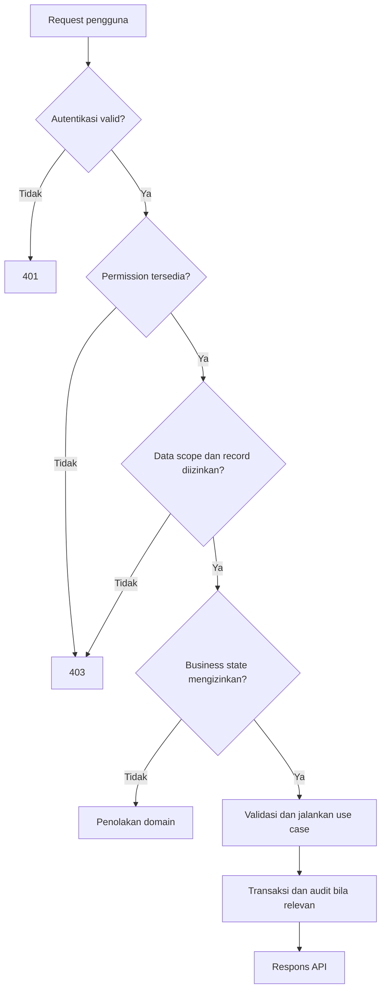
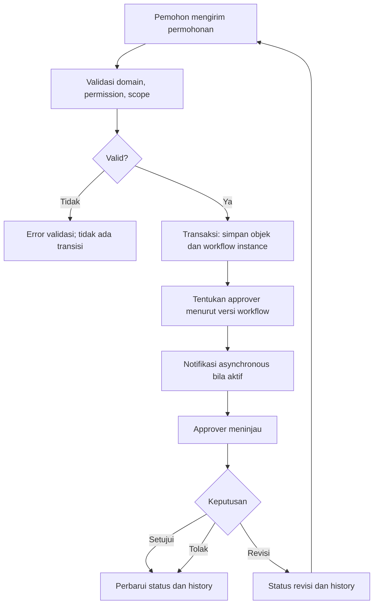
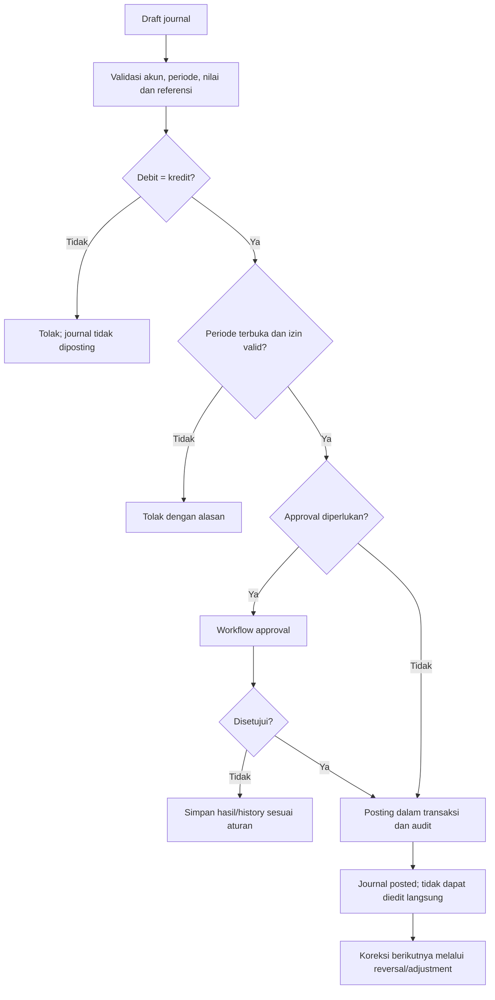
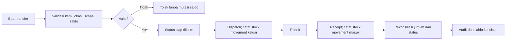
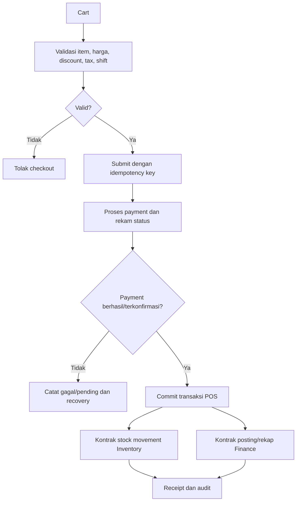
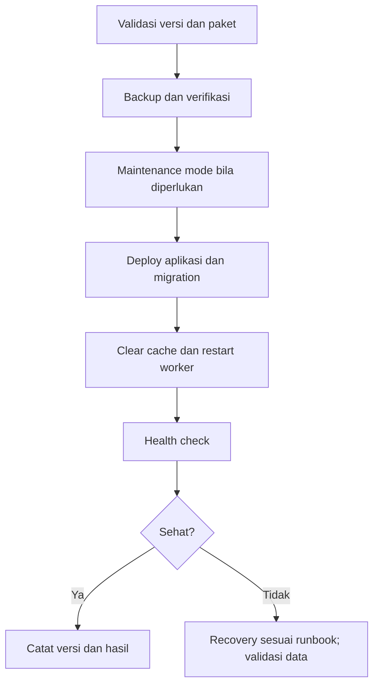

# Business Process Specification (BPS)

| Atribut | Nilai |
|---|---|
| Document Code | DOC-005 |
| Document Version | 0.1 |
| Document Status | DRAFT |
| Created Date | 2026-11-04 |
| Last Updated | 2026-11-04 |
| Document Owner | TBD — Business Process Owner |
| Related Documents | `brs.md`, `frs.md`, `use-case-specification.md`, `business-rules-specification.md`, `../../docs/MTS.md` |

## 1. Tujuan dan Cakupan

Menjelaskan alur lintas fungsi yang tersurat atau secara langsung dibutuhkan oleh capability MTS. Diagram adalah alur konseptual, bukan persetujuan atas semua state, SLA, role, maupun kebijakan bisnis.

## 2. Prinsip Proses

- Backend memvalidasi permission, data scope, dan business state.
- Perubahan atomik diproses dalam database transaction.
- Proses lanjutan dapat asynchronous; status dan retry harus dapat diamati.
- Perubahan finance/inventory tidak boleh menghapus jejak transaksi asal.
- Workflow hanya diberlakukan bila dikonfigurasi dan disetujui.

## 3. Proses

### BPS-CORE-001 — Akses ke data bisnis

**Trace:** SYS-AUTH-001/002, FUN-AUTH-001/002.

Scope dilaksanakan backend. Strategi penyamaran record di luar scope pada response (misalnya 403/404) perlu konsistensi API dan review security.

### BPS-WF-001 — Persetujuan generik

**Trace:** FUN-WF-001, UC-WF-001.

Conditional routing, delegasi, eskalasi, withdrawal, dan SLA menunggu konfigurasi/policy. Penolakan tidak menghapus riwayat.

### BPS-FIN-001 — Validasi dan posting jurnal

**Trace:** FUN-FIN-001, UC-FIN-001.

### BPS-INV-001 — Transfer stok

**Trace:** FUN-INV-001/002, UC-INV-001.

Aturan selisih, backorder, costing, reservation, lot/serial, dan cancellation harus ditetapkan pada pack Inventory. Tidak boleh ada saldo yang diubah langsung tanpa movement.

### BPS-POS-001 — Checkout dan dampak transaksi

**Trace:** FUN-POS-001, BUS-POS-001.

Atomicity lintas modul, payment timeout, dan sinkronisasi inventory/finance harus ditetapkan pada desain integrasi; diagram tidak mengasumsikan transaksi database lintas provider.

### BPS-OPS-001 — Update sistem

**Trace:** FUN-ADM-003.

## 4. Kontrol Lintas Proses

- Setiap penolakan/konflik harus menghasilkan error yang konsisten, tanpa mutasi parsial.
- Operasi kritis memerlukan audit yang tidak memuat credential/secret.
- Event/notifikasi setelah commit harus punya strategi kegagalan yang ditentukan DOC-020.
- Proses asynchronous tidak boleh dianggap selesai sebelum statusnya terkonfirmasi.

## 5. Batasan dan Open Issues

Role/approval authority, nominal threshold, SLA/escalation, accounting close, refund/return rules, payment provider, stock discrepancy, inventory valuation, backup policy dan recovery objectives belum diatur oleh sumber yang tersedia.

| ID | Isu | Status |
|---|---|---|
| BPS-OPEN-001 | Detail state machine untuk proses domain belum ditetapkan. | TBC |
| BPS-OPEN-002 | Konsistensi lintas modul POS-payment-inventory-finance memerlukan keputusan integrasi. | ADR Required |
| BPS-OPEN-003 | Approval matrix dan SLA organisasi belum tersedia. | TBD |

## References

- `../../docs/MTS.md`, §§3.2, 5.4–5.7, 6.2, 6.6–6.7, 15–16.
- `frs.md` DOC-003; `use-case-specification.md` DOC-004.

## Change History

| Versi | Tanggal | Perubahan | Penulis |
|---|---|---|---|
| 0.1 | 2026-11-04 | Alur proses konseptual untuk akses, workflow, finance, inventory, POS, operations | Documentation Agent |
