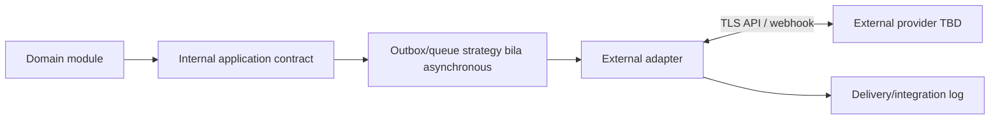

# Integration Architecture Specification (IAS)

| Atribut | Nilai |
|---|---|
| Document Code | DOC-011 |
| Document Version | 0.1 |
| Document Status | DRAFT |
| Created Date | 2026-11-04 |
| Last Updated | 2026-11-04 |
| Document Owner | TBD — Integration Architect |
| Related Documents | `sad.md`, `module-architecture/module-architecture-specification.md`, `module-dependency-matrix.md`, `../04-backend/api/`, `../../docs/MTS.md` |

## 1. Tujuan dan Scope

Menetapkan pola integrasi internal dan eksternal sesuai MTS. Provider, payload schema, retry windows, SLA dan deployment endpoints tetap TBD sampai ada keputusan/kontrak.

## 2. Prinsip Integrasi

- Modular monolith tetap satu aplikasi; komunikasi internal melalui application service/public contract, query interface, atau domain event.
- Synchronous API dipakai ketika caller membutuhkan hasil validasi/keputusan segera; operasi panjang/notification/report/import dapat asynchronous bila kontraknya mengizinkan.
- Tidak ada write langsung ke tabel milik modul lain.
- Transaksi penting yang memicu event mempertimbangkan transactional outbox untuk mencegah kehilangan sinkronisasi.
- API eksternal terautentikasi, tervalidasi, rate-limited sesuai risiko; webhook diverifikasi signature dan diproses idempotent.
- Secrets tidak masuk source code, response, atau logs.

## 3. Internal Integration Map

| Caller | Provider/owner | Fungsi kontrak | Kandidat pola |
|---|---|---|---|
| HRM | Finance | Handoff payroll result/journal | Command/application service; rule and payroll scope TBD |
| Sales | CRM | Customer/contact reference, lead conversion context | Query/contract |
| Sales | Finance | Invoice creation/reference | Command + asynchronous result/event bila sesuai |
| POS | Inventory | Product/availability lookup dan stock movement | Synchronous validation + post-commit command/event; atomicity TBD |
| POS | Finance | Sales/payment journal/reconciliation handoff | Contract/event; accounting mapping TBD |
| Project | HRM | Employee/member reference | Query/read contract |
| Project | Finance | Project budget/cost/expense/revenue reference | Domain contract |
| LMS | HRM | Employee training/learning reference | Query/command contracts |
| All modules | Core | Authz, organization scope, workflow, audit, notification, document/numbering | Shared application contracts |
| Analytics | Domain owners | Controlled read/report data | Query/read model; isolation/freshness TBD |

## 4. External Integration Pattern

MTS menyebut SMTP/email, payment gateway, banking API, tax service, cloud storage, messaging provider, accounting export, external HR systems, dan webhook consumer sebagai kemungkinan. Tidak ada provider/contract yang telah dipilih.

Per integrasi, spesifikasikan owner, data classification, auth/secrets, request/response, timeout, retry/backoff, idempotency, signature, ordering, rate limits, reconciliation, failure/dead-letter handling, observability, test sandbox, versioning, and deactivation procedure.

## 5. Webhooks, Import/Export

Webhook: endpoint registration/subscriptions, signature verification, timeout, retry, delivery log, idempotent consumer. Arah webhook (inbound/outbound), signing algorithm, retry schedule, secret rotation TBD.

Import/export: CSV/XLSX input, mapping/template, validation, preview, duplicate detection, error report, transaction strategy; heavy jobs may use queue. PDF exports and controlled reporting follow owner authorization. File size/type/retention limits TBD.

## 6. Consistency and Failure

- Synchronous failure returns documented API/domain error and does not leave partial mutation.
- Async delivery records correlation/request ID and outcome; retry does not duplicate side effects.
- For cross-module operation, define source of truth, operation ID, idempotency key, state machine, compensation/reconciliation, and terminal status before implementation.
- Do not claim exactly-once delivery; use idempotent processing and durable state according to implementation decision.

## 7. Open Issues

Cross-module transaction semantics, outbox mechanism, event schema/versioning, customer/product master ownership, finance mapping, webhook provider contract, external credentials, import limits, and reporting architecture need decisions.

## References / Change History

MTS §§3.2, 3.3, 8.6, 11; DOC-007, DOC-010, DOC-012, DOC-020.

| Versi | Tanggal | Perubahan | Penulis |
|---|---|---|---|
| 0.1 | 2026-11-04 | Pola integrasi dan kandidat hubungan antarmodul | Documentation Agent |
