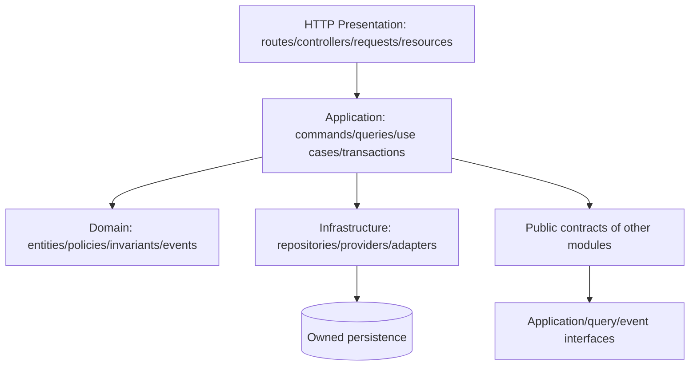

# Module Architecture Specification (MAS)

| Atribut | Nilai |
|---|---|
| Document Code | DOC-010 |
| Document Version | 0.1 |
| Document Status | DRAFT |
| Created Date | 2026-11-04 |
| Last Updated | 2026-11-04 |
| Document Owner | TBD — Module/Domain Architects |
| Related Documents | `../sad.md`, `../integration-architecture.md`, `../module-dependency-matrix.md`, `../../01-requirements/frs.md`, `../../../docs/MTS.md` |

## 1. Tujuan dan Batas

Menetapkan boundary dan ownership konseptual modul. Ini bukan schema/API final. MTS menyebut modular monolith: setiap modul memiliki domain model, business rules, application services, data access, API endpoints, events, permissions, dan tests. Interaksi mengikuti kontrak.

## 2. Boundary Rules

1. Satu modul menjadi pemilik tulis dan invariant data domainnya.
2. Modul konsumen memakai application service/public interface/event/query contract; tidak melakukan direct cross-domain writes.
3. Referensi antardomain menyimpan ID/reference yang didefinisikan kontrak; cascade/delete harus mempertahankan historical transactions.
4. Authn, RBAC/data scope, audit, workflow, notification, file, numbering, configuration dan import/export adalah shared core capabilities; modul tetap menentukan permission/validation domain-nya.
5. Domain logic tidak bergantung pada HTTP/UI. Application service mengoordinasikan use case dan transaction.
6. Transaction lintas domain dan event consistency dirinci pada DOC-011/020; jangan mengasumsikan atomic transaction melintasi external provider.

## 3. Domain Ownership

| Modul | Data/kapabilitas pemilik (konseptual) | Kontrak konsumsi utama |
|---|---|---|
| Organization | Organization profile dan hierarchy: business unit, branch, division, department, team, position | Organization reference, hierarchy/scope query |
| Identity | User, credential, profile, session, activation/suspension, login history | Authentication principal/session contract |
| Access Control | Role, permission, user-role, role-permission dan authorization policy | Permission/scope decision interface |
| Workflow | Definition/version/step/instance/approval/history | Start/decide workflow contract dan status event |
| Notification | Template, preferences, notification/delivery history | Notification command/event |
| Audit | Audit/activity logs | Append audit contract, restricted query |
| Documents | File/version/category/relations dan access policy | Authorized file/document interface |
| Shared Configuration | System/module configuration, custom fields, numbering, import/export orchestration | Configuration/read/command contracts |
| HRM | Employee/employment, recruitment, attendance, leave, payroll, performance, training record | Employee reference; payroll handoff ke Finance mengikuti kontrak TBD |
| Finance & Accounting | CoA, periods, journals/lines, ledgers, AR/AP, cash/bank, expense, budget, reports | Invoice/payment/journal contracts dan reference dimensions |
| CRM | Lead, contact/customer relationship, pipeline/opportunity, interaction history | Customer/contact reference ke Sales/POS sesuai kontrak |
| Sales | Quotation, sales items, discount/tax, sales order/status | CRM customer/product reference; invoice request ke Finance |
| Project Management | Project, task, milestone, timesheet, resource/cost/revenue tracking | Employee reference dari HRM; financial references Finance |
| Collaboration | Announcement, discussion/messages, calendar/meeting, shared activity | User/org/project access context; notification |
| Inventory | Product/category/SKU/UOM, warehouse/location, stock movement/balance/transfer/adjustment/valuation | Stock movement/availability/value contracts ke POS/Sales/Finance |
| POS | Terminal, cashier shift, cart/transaction/payment/receipt/return/refund/cash closing | Product/customer lookup; Inventory movements; Finance handoff |
| LMS | Course/content/enrollment/assessment/progress/certification | Employee/org references dan notifications |
| Analytics & Reporting | Dashboard/report definitions dan controlled read/query model | Read-only contracts/data products dari domain sumber |
| System Administration | Installation/configuration ops, module admin, queue/scheduler/health, update/backup status | Operational health/control interfaces; tidak memiliki domain transaksi bisnis |

Kepemilikan data detail harus ditinjau sebelum schema dibekukan. Contoh entity dalam MTS adalah daftar awal, bukan seluruh model lengkap.

## 4. Layer Internal Modul

Laravel dapat menggunakan konvensi framework sepanjang boundary tetap terjaga. Diagram adalah logical view, bukan diwajibkan menjadi folder persis.

## 5. Error/Transaction/Testing

Setiap modul menerapkan validation domain, authorization delegation ke Core, transaction boundary pada use case, domain error yang dipetakan konsisten ke API, audit untuk operasi kritis, dan unit/integration/contract tests. Kegagalan downstream asynchronous harus memiliki status/retry sesuai DOC-020.

## 6. Open Issues

- Kepemilikan customer antara CRM/Sales/POS dan kepemilikan product/price antara Inventory/Sales/POS perlu kontrak eksplisit.
- “Organization/company” accounting belum disepakati.
- Payroll, stock costing, journal integration, cross-module transaction/outbox semantics, read model dan custom workflow scope adalah TBD/ADR Required.
- MTS memberikan submodul capability; release inclusion/prioritas bukan keputusan arsitektur ini.

## References / Change History

MTS §§2.2, 3.3, 5–7, 11, 13; DOC-007, DOC-011, DOC-012.

| Versi | Tanggal | Perubahan | Penulis |
|---|---|---|---|
| 0.1 | 2026-11-04 | Ownership/boundary konseptual seluruh core dan business modules | Documentation Agent |
