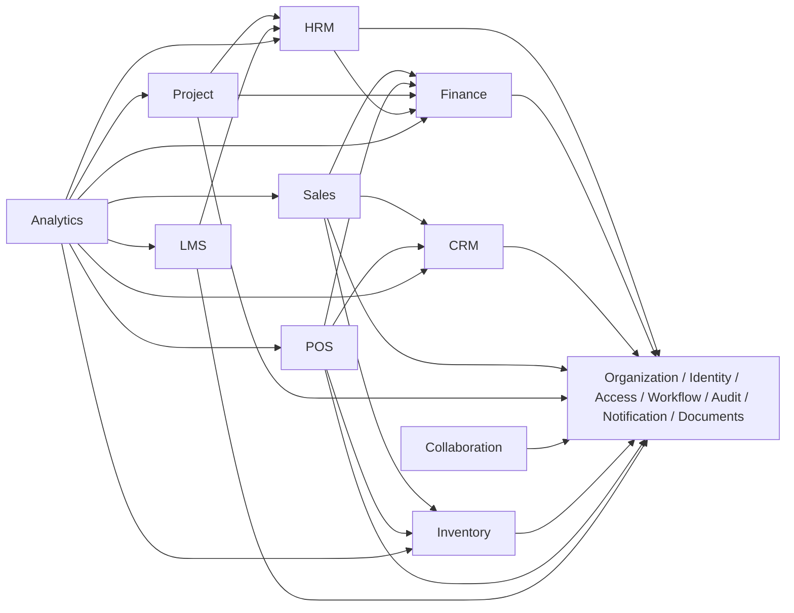

# Module Dependency Matrix (MDM)

| Atribut | Nilai |
|---|---|
| Document Code | DOC-012 |
| Document Version | 0.1 |
| Document Status | DRAFT |
| Created Date | 2026-11-04 |
| Last Updated | 2026-11-04 |
| Document Owner | TBD — Solution Architect |
| Related Documents | `sad.md`, `module-architecture/module-architecture-specification.md`, `integration-architecture.md`, `../../docs/MTS.md` |

## 1. Tujuan dan Aturan

Mencatat dependency logical dari MTS sebagai input desain; panah menunjukkan consumer → provider dan bukan urutan release atau izin akses tabel. Dependency tidak mengizinkan consumer menulis data provider secara langsung. Integrasi, API, event, dan data contracts harus disahkan per DOC-011/019/020.

## 2. Dependency Matrix

| Consumer | Organization | Identity/Access | Workflow | Notification/Audit/Docs | HRM | Finance | CRM | Sales | Project | Collaboration | Inventory | POS | LMS | Analytics | System Admin |
|---|---|---|---|---|---|---|---|---|---|---|---|---|---|---|---|
| Core services | — | — | — | — |  |  |  |  |  |  |  |  |  |  |  |
| HRM | R | R | C | C | — | C |  |  |  |  |  |  | C | R |  |
| Finance & Accounting | R | R | C | C | C | — | C | C | C |  | C | C |  | R |  |
| CRM | R | R | C | C |  |  | — | C |  | C |  |  |  | R |  |
| Sales | R | R | C | C |  | C | C | — |  | C | C |  |  | R |  |
| Project Management | R | R | C | C | C | C |  |  | — | C |  |  |  | R |  |
| Collaboration | R | R | C | C | R |  |  |  | R | — |  |  |  | R |  |
| Inventory | R | R | C | C |  | C |  | C |  |  | — | C |  | R |  |
| POS | R | R | C | C |  | C | C | C |  |  | C | — |  | R |  |
| LMS | R | R | C | C | C |  |  |  |  |  |  |  | — | R |  |
| Analytics & Reporting | R | R |  |  | R | R | R | R | R | R | R | R | R | — |  |
| System Administration | R | R |  |  |  |  |  |  |  |  |  |  |  | R | — |

**Legend:** `R` = reference/read contract dependency (exact data and scope TBD); `C` = conditional integration/capability or workflow/audit/document service; blank = no dependency asserted by MTS; `—` = same module. This is a conservative proposed map, not an approved interface inventory. Core services are shared infrastructure, not a single mega-module.

## 3. Dependency Diagram

Arrows indicate candidate logical/reference dependency only. Not all CRM/Finance or other module links in the matrix are mandated by MTS; they are marked conditional and require owner validation.

## 4. Governance Rules

- Acyclic compile-time dependency is preferred; cycles require explicit architectural review.
- Core must not depend on business modules.
- Analytics reads through controlled query/read contracts; no direct unrestricted joins are assumed.
- Cross-module commands/events have schema/version/owner and security tests.
- Changes to provider contracts require compatibility review and traceability updates.

## 5. Risks and Open Issues

The matrix includes hypotheses where MTS says “integrates with” but does not state ownership/contract. Product/customer ownership, Finance posting responsibility, POS-to-stock consistency, project cost source, analytics data access and dependency cycles must be resolved with module owners. Release ordering follows roadmap only as a recommendation, not an immutable dependency.

## References / Change History

MTS §§3.3, 6, 11, 20; DOC-007, DOC-010, DOC-011.

| Versi | Tanggal | Perubahan | Penulis |
|---|---|---|---|
| 0.1 | 2026-11-04 | Matriks dependency konseptual semua domain | Documentation Agent |
