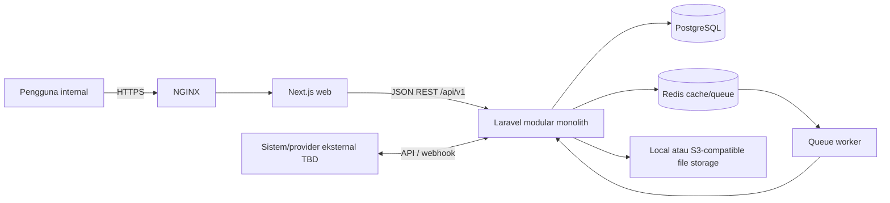

# Software Architecture Description (SAD)

| Atribut | Nilai |
|---|---|
| Document Code | DOC-007 |
| Document Version | 0.1 |
| Document Status | DRAFT |
| Created Date | 2026-11-04 |
| Last Updated | 2026-11-04 |
| Document Owner | TBD — Software Architect |
| Related Documents | `../01-requirements/srs.md`, `sas.md`, `adr/architecture-decisions.md`, `module-dependency-matrix.md`, `../../docs/MTS.md` |

## Tujuan dan Scope

Menjelaskan arsitektur perangkat lunak BOS sesuai MTS v1.0 Draft Baseline. Berlaku untuk satu instalasi organisasi, web app dan API, modular monolith, serta layanan runtime pendukung. Tidak mencakup microservices/SaaS multi-tenant.

## Drivers dan Constraints

- Kebutuhan utama: integrasi capability organisasi; boundary domain; API-first; self-hosted; keamanan backend; data relational integrity; operasi yang dapat di-backup/di-restore.
- Constraint MTS: modular monolith, REST API, single-tenant, organisasi internal hierarkis, PostgreSQL, Redis, Docker Compose, NGINX, Linux.
- Laravel/PHP dan Next.js/React/TypeScript adalah arah stack; MTS mencatat keputusan terkait sebagai Proposed pada tabel ADR. Versi final runtime TBD.

## Context

Diagram menunjukkan logical target dari MTS, bukan topologi high availability atau provider yang telah dipilih.

## Logical Architecture

1. **Presentation:** Next.js/React/TypeScript; navigation, forms, dashboards, feature components. UI boleh menyesuaikan permission tetapi bukan otoritas.
2. **API:** routing `/api/v1`, request validation, auth middleware, authorization, rate limiting, response/error formatting, versioning.
3. **Application:** use-case orchestration, transaction boundary, idempotency, coordination terhadap domain/kontrak lain.
4. **Domain:** entity/value object/policy/domain service/event dan invariant; tidak bergantung pada HTTP/UI.
5. **Infrastructure:** repository/persistence, Redis queue/cache, storage, email/external clients, scheduler/logging.
6. **Deployment:** NGINX, frontend/backend runtime, PostgreSQL, Redis, worker, scheduler, persistent storage melalui container/runtime sesuai konfigurasi.

## Module Boundaries

Core berisi Organization, Identity, Access Control, Workflow, Notification, Audit, Documents, serta shared configuration/numbering/custom fields/import-export. Business modules: HRM, Finance, CRM, Sales, Project Management, Collaboration, Inventory, POS, LMS, Analytics & Reporting. System Administration mengoperasikan module/configuration/runtime. Kepemilikan data dan arah interaksi dirinci DOC-010/012. Modul tidak menulis tabel internal modul lain secara sembarang.

## Runtime Interactions

- Request sinkron: HTTPS → NGINX → frontend/API → authentication → authorization/scope → validation → application/domain → repository/PostgreSQL → response.
- Background: use case commit data → event/job/outbox strategy sesuai kebutuhan → Redis queue → worker → handler → result/log/notification.
- Transaksi yang harus atomik menggunakan DB transaction; publikasi event penting mempertimbangkan transactional outbox.

## Quality Attributes

Security by design; modularity; relational integrity; auditability; maintainability; performance targets MTS §17.1 sebagai baseline uji, bukan jaminan. Availability, scalability capacity, RPO/RTO, browser/runtime compatibility matrix menunggu keputusan.

## Dependencies, Assumptions, Open Issues

Storage provider, authentication strategy universal, search engine, reporting/read model, primary key, multi-company accounting, external providers, deployment HA, and exact versions remain TBD/ADR Required per MTS. No assumption changes one-org-per-installation.

## References / Change History

MTS v1.0 §§1–4, 11–17, 21–23; DOC-002 SRS; DOC-008 SAS.

| Versi | Tanggal | Perubahan | Penulis |
|---|---|---|---|
| 0.1 | 2026-11-04 | Draf arsitektur perangkat lunak berdasarkan MTS | Documentation Agent |
