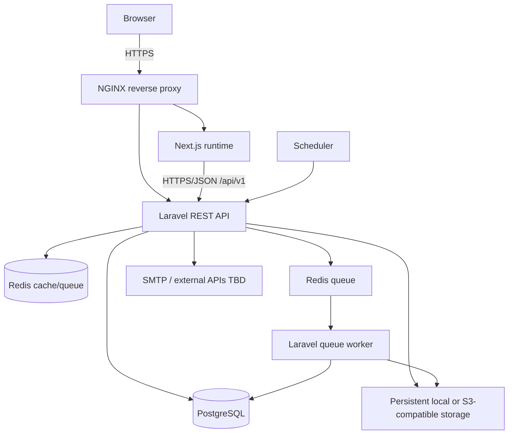
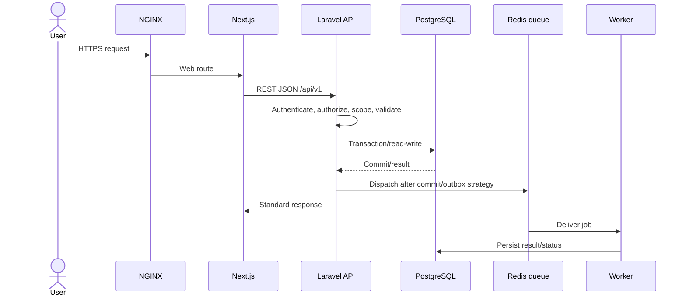

# System Architecture Specification (SAS)

| Atribut | Nilai |
|---|---|
| Document Code | DOC-008 |
| Document Version | 0.1 |
| Document Status | DRAFT |
| Created Date | 2026-11-04 |
| Last Updated | 2026-11-04 |
| Document Owner | TBD — Solution Architect |
| Related Documents | `sad.md`, `../06-security-infrastructure/infrastructure-deployment.md`, `../04-backend/backend-technical-specification.md`, `../../docs/MTS.md` |

## 1. Tujuan dan Scope

Mendeskripsikan komponen sistem, tanggung jawab, komunikasi, dan boundary runtime untuk desain self-hosted BOS. Detail host sizing, availability, ports, network policy, domain topology, serta provider belum tersedia dan tidak difinalisasi di sini.

## 2. Component/Container View

## 3. Logical Responsibilities

| Komponen | Tanggung jawab | Boundary |
|---|---|---|
| NGINX | Reverse proxy dan HTTPS termination/routing sesuai deployment | Tidak menjalankan domain logic |
| Next.js frontend | UI rendering, navigation, client state, API client | Tidak menjadi kontrol authorization final |
| Laravel backend | REST API, authn/authz, validation, use cases, transaction, events, jobs | Satu backend modular; domain ownership di DOC-010 |
| PostgreSQL | Relational system of record, FK/constraints, transactional state, migrations | Database utama per instalasi |
| Redis | Cache, queue, rate limiting/temp state/locks bila diperlukan | Persistensi bisnis tetap di PostgreSQL kecuali keputusan terpisah |
| Worker/scheduler | Menjalankan job async dan scheduled task | Retry/timeout/failure policy DOC-020 |
| File storage | File di luar public web root, akses terlindungi | Local atau S3-compatible; pilihan belum final |
| External services | SMTP/provider/payment/banking/tax/webhooks | Provider, credential, SLA, contract TBD |

## 4. Request/Data Flow

Event publication semantics and whether outbox is mandatory per event are TBD in DOC-020.

## 5. Deployment/Trust Boundaries

Production minimum services in MTS: NGINX, Next.js, Laravel, PostgreSQL, Redis, worker, scheduler, persistent file storage. Docker Compose orchestrates conceptual services. Production secrets/configuration and persistent volumes are separated. HTTPS externally; internal network segmentation, port map, host hardening, TLS certificates and container privileges require DOC-027/028 decisions.

## 6. Failure/Recovery Behavior

Database unavailability blocks transactional requests and must fail closed; queue unavailability may defer async work only where contract permits; storage/provider errors surface controlled errors and retry according to job policy. Health checks, alert thresholds, retention, backup schedules, recovery objectives, high availability, and exact degraded modes are TBD.

## 7. Constraints/Open Issues

Single-tenant per install; no tenant routing; modular monolith; PostgreSQL relational system of record. Runtime versions, sizing/concurrency, topology, storage, authentication mode, external providers, RPO/RTO, and availability target are not set.

## References / Change History

MTS §§1.3, 3, 4, 15–17; DOC-007 SAD; DOC-027 Security; DOC-028 IDS.

| Versi | Tanggal | Perubahan | Penulis |
|---|---|---|---|
| 0.1 | 2026-11-04 | View logical components, flow, and operational boundary | Documentation Agent |
