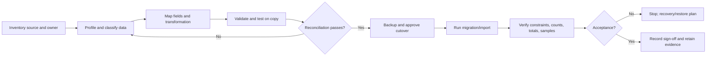

# Data Migration Specification (DMS)

| Atribut | Nilai |
|---|---|
| Document Code | DOC-017 |
| Document Version | 0.1 |
| Document Status | DRAFT |
| Created Date | 2026-11-04 |
| Last Updated | 2026-11-04 |
| Document Owner | TBD — Data Migration Lead |
| Related Documents | `database-design.md`, `data-dictionary.md`, `data-governance.md`, `../06-security-infrastructure/backup-disaster-recovery.md`, `../../docs/MTS.md` |

## 1. Tujuan dan Scope

Menetapkan kerangka migrasi schema dan data untuk deployment self-hosted BOS. MTS belum mengidentifikasi legacy source, volume, cutover window, cleansing rules atau source format; rencana proyek per pelanggan/organisasi harus mengisi detail tersebut sebelum eksekusi.

## 2. Migration Types

1. **Schema migration:** perubahan skema PostgreSQL melalui migration versioned.
2. **Seed/reference data:** data minimal/configuration yang disetujui; tidak menanam policy bisnis tanpa approval.
3. **Legacy data import:** CSV/XLSX atau sumber lain setelah mapping dan profil data disetujui.
4. **Backfill/reconciliation:** transformasi terkontrol untuk kolom/relasi baru dan read model.

## 3. Process

## 4. Mapping and Validation Requirements

Per dataset, catat owner/source system, extract timestamp, row counts, field mapping, type conversion, normalization, reference resolution, duplicates, null handling, rejected row treatment, sensitive fields, transformation version, and audit/correlation identifiers. Validation must run before write and report rejected records with safe error detail. Financial totals and stock quantities require domain-owner reconciliation; no automatic rounding/costing assumption.

## 5. Execution and Integrity

- Test migration against representative copy with versioned scripts and measured runtime/locks.
- Pre-cutover backup includes PostgreSQL and files/configuration as appropriate; restore is verified.
- Select transaction/batch size and downtime strategy from volume and constraints, currently TBD.
- Enforce FKs/unique constraints and maintain source-to-target mapping where reconciliation requires.
- Do not use destructive rollback as sole recovery; restore/compensation must account for writes after cutover.
- Record start/end, code/version, operator, counts, validation outcome, exceptions and approval.

## 6. Acceptance / Rollback

Acceptance thresholds (counts, totals, error rate, sample checks, downtime) are dataset-specific and approved before run. If a critical validation fails, stop and follow approved recovery plan; preserve logs/evidence while redacting sensitive data. RPO/RTO and rollback window are TBD.

## 7. Open Issues

No legacy systems/data extract are described in MTS. Source systems, mappings, data ownership, volume, quality, identifiers, duplicate policy, privacy/legal retention, cutover window, downtime, reconciliation thresholds and business approver remain TBD.

## References / Change History

MTS §§7.1, 7.8, 11.4, 15.4–15.5, 16.4; DOC-013/015/016, DOC-029.

| Versi | Tanggal | Perubahan | Penulis |
|---|---|---|---|
| 0.1 | 2026-11-04 | Kerangka migrasi schema/data, menunggu data source dan kebijakan | Documentation Agent |
