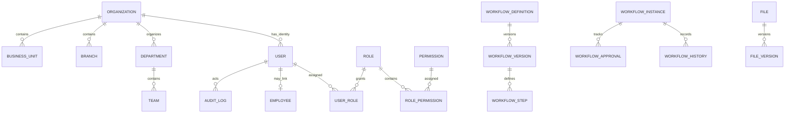
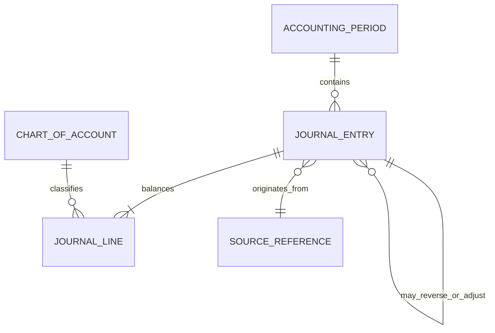
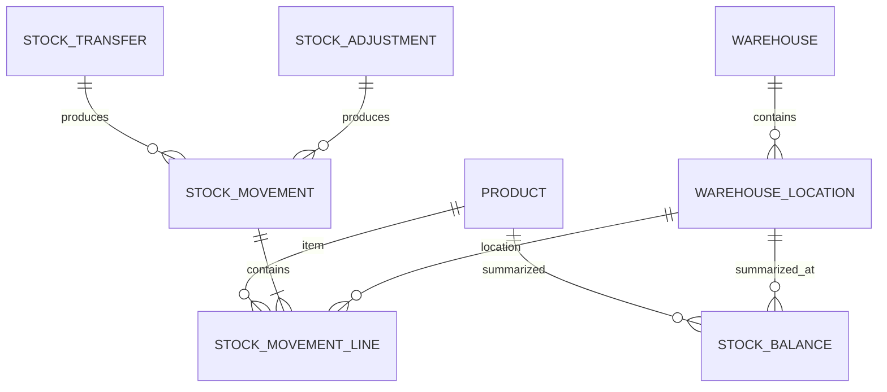

# Entity Relationship Specification (ERS)

| Atribut | Nilai |
|---|---|
| Document Code | DOC-014 |
| Document Version | 0.1 |
| Document Status | DRAFT |
| Created Date | 2026-11-04 |
| Last Updated | 2026-11-04 |
| Document Owner | TBD — Data Architect |
| Related Documents | `database-design.md`, `data-dictionary.md`, `../02-architecture/module-architecture/module-architecture-specification.md`, `../../docs/MTS.md` |

## 1. Tujuan dan Batas

Mencatat ER model konseptual dari entity awal MTS. Cardinality yang tidak ditentukan sumber ditandai sebagai calon relasi; tidak menyiratkan semua tabel telah disetujui. Tipe PK, nullable, FK action, dan cardinality final TBD sampai schema review.

## 2. Conceptual Core ERD

ERD menunjukkan relasi yang tersurat/konseptual; organization level/parent-child hierarchy dapat berupa hierarki fleksibel sesuai MTS, bukan struktur wajib yang seluruh cabangnya harus ada. Relasi User-Employee opsional, bukan satu-ke-satu final. Workflow object target/business entity reference design TBD.

## 3. Conceptual Finance ERD

`SOURCE_REFERENCE` dan hubungan reversal/adjustment digambarkan konseptual; implementasinya dapat memakai typed relation atau kontrak lain setelah ownership/migration ditinjau. Journal entry posted immutable melalui proses normal.

## 4. Conceptual Inventory ERD

Stock balance adalah derived/read model atau saldo terhitung sesuai desain yang konsisten; stock movement adalah riwayat sumber kebenaran. Lot/serial/batch optional sesuai kebutuhan.

## 5. Relational Constraints to Resolve

| Area | Kandidat constraint | Belum diputuskan |
|---|---|---|
| Organization hierarchy | self-reference parent_id atau closure/hierarchy model | model, uniqueness, cross-parent validity |
| Identity | unique login identifier; user-role unique pair | email/username normalization dan scope |
| Role/Permission | unique permission code; unique role-permission pair | role scope dan custom role uniqueness |
| Document numbering | unique rendered number pada sequence scope | scope organisasi/cabang/periode dan concurrency strategy |
| Journal | FK period/account; checks amount nonnegative dan debit/credit rule | precision, currency, zero-line, rounding |
| Stock | FK product/location; movement reference; balance key | negative stock, lot/serial, costing, dimensions |

## 6. Open Issues

Entitas CRM/Sales/POS customer/product ownership; multi-company accounting; employee/user relationship cardinality; workflow target references; custom-field storage; audit partition/retention; FK deletion policy; all physical cardinalities/types remain TBD.

## References / Change History

MTS §§5.1–5.9, 7.4–7.7; DOC-013, DOC-015.

| Versi | Tanggal | Perubahan | Penulis |
|---|---|---|---|
| 0.1 | 2026-11-04 | ERD konseptual core, finance, inventory | Documentation Agent |
