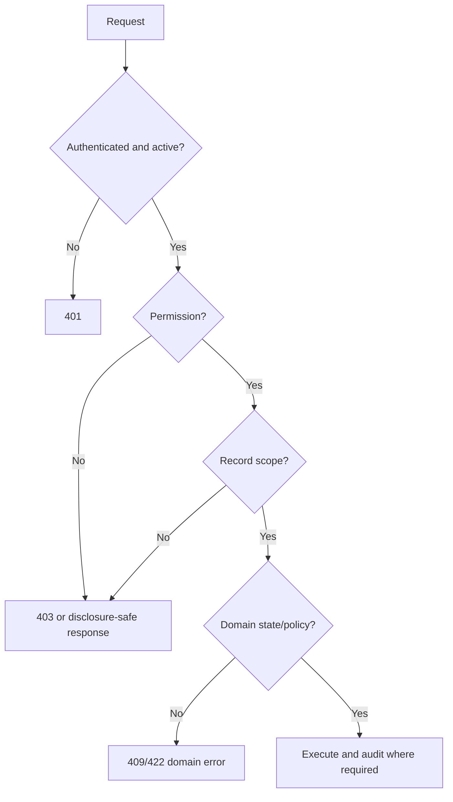

# Authentication & Authorization Specification (AAS)

| Atribut | Nilai |
|---|---|
| Document Code | DOC-021 |
| Document Version | 0.1 |
| Document Status | DRAFT |
| Created Date | 2026-11-04 |
| Last Updated | 2026-11-04 |
| Document Owner | TBD — Security Architect / Identity Owner |
| Related Documents | `../01-requirements/srs.md`, `../02-architecture/sad.md`, `../06-security-infrastructure/security-specification.md`, `api/api-specification.md`, `../../docs/MTS.md` |

## 1. Tujuan dan Trust Boundary

Menetapkan baseline authn/authz. Backend Laravel menjadi otoritas; UI permission-aware hanya untuk UX. Sistem single-tenant tetap membutuhkan organization data scope. Cookie-session disebut MTS sebagai pilihan baik untuk first-party web bila domain cocok; universal strategy/session-vs-token belum final.

## 2. Authentication Requirements

- Email/username + password sebagaimana identifier yang dipilih; hash memakai algoritma rekomendasi framework.
- Password reset, account activation/suspension, login history, session revocation/expiration dan login throttling.
- Untuk cookie session: HttpOnly, Secure pada HTTPS, SameSite policy, CSRF protection, session invalidation; exact cookie domain/duration TBD.
- Do not expose account existence through reset/login response unless policy explicitly permits.
- Optional MFA adalah kemampuan future, bukan baseline mandatory.
- Secret tidak disimpan di source code atau audit/log. HTTPS wajib production.

## 3. Authorization Model

`User → UserRole → Role → RolePermission → Permission`; permission naming `module.resource.action` (contoh MTS). Backend endpoint/policy checks:

1. Principal authenticated and active?
2. Permission granted?
3. Record belongs to permitted data scope (organization, business unit, branch, department, own record, assigned project)?
4. Business state/workflow permits the action?
5. Is sensitive action audited?

Scope resolution must be server-side and must not accept client-supplied scope as authority. Query-level scoping is required to avoid IDOR/list-vs-detail inconsistencies. Default deny; least privilege; sensitive export/download separately authorized.

## 4. Access Decision Flow

Response 403 vs 404 for inaccessible record needs consistent security/API decision. Authorization must be repeated on mutation and file access, not inferred from previous page fetch.

## 5. Permission and Scope Administration

Built-in roles may be configured; role catalog and assignment matrix remain per module. Do not use role name alone as an authorization check. Permission granularity, scope inheritance, multiple-role merge, deny/allow precedence, temporary grants, emergency access, review cadence and segregation-of-duties rules need owner approval.

## 6. Threat Controls

CSRF for cookie sessions; XSS output encoding; SQL injection prevention; IDOR scope checks; mass assignment allowlists; login throttling; session rotation/revocation; file authorization; audit redaction; secrets management; access review. Security test cases in DOC-030.

## 7. Open Decisions

Cookie sessions vs token strategy for all clients; password complexity/expiration policy; MFA; account lockout/reset verification; session lifetime; login identifier; role/scope inheritance; API client/service credentials; CSRF/cross-origin domain; inaccessible-record response; audit retention.

## References / Change History

MTS §§2.5, 5.2–5.4, 9–10; DOC-018, DOC-019, DOC-027.

| Versi | Tanggal | Perubahan | Penulis |
|---|---|---|---|
| 0.1 | 2026-11-04 | Authn/authz model and open decisions | Documentation Agent |
