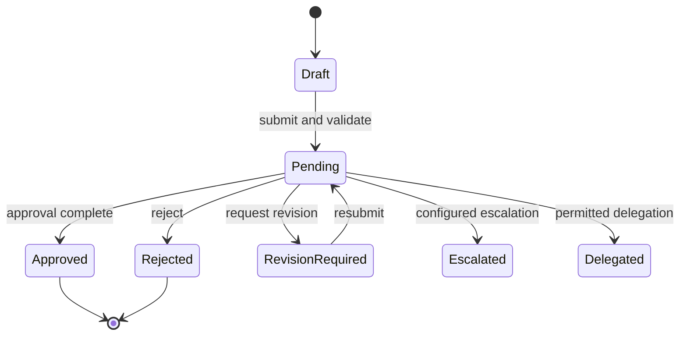

# Workflow Engine Specification (WES)

| Atribut | Nilai |
|---|---|
| Document Code | DOC-022 |
| Document Version | 0.1 |
| Document Status | DRAFT |
| Created Date | 2026-11-04 |
| Last Updated | 2026-11-04 |
| Document Owner | TBD — Workflow Product/Technical Owner |
| Related Documents | `../01-requirements/business-process-specification.md`, `business-rules-specification.md`, `backend-technical-specification.md`, `authentication-authorization.md`, `../../docs/MTS.md` |

## 1. Tujuan dan Kapabilitas

MTS workflow supports definition/version, step, approval-level, approver assignment, conditional routing, delegation, rejection, revision, escalation and approval history. Candidate use cases: leave, purchase, expense, sales discount, journal and project budget approval. This specification sets engine responsibilities but leaves business policies/configurable process definitions unresolved.

## 2. Conceptual Model

- Definition: named process and activation/owner.
- Version: immutable snapshot of steps/conditions used by an instance.
- Step: ordered or condition-routed state requiring action/automation.
- Instance: process state linked to a business object by typed contract/reference.
- Assignment: user/role/scope or resolver result for approver; exact representation TBD.
- Decision/history: actor, action, timestamp, comment/context and transition; tamper-resistant policy required.

## 3. Lifecycle (Conceptual)

State list is a conceptual superset; exact terminal states, cancellation/withdrawal, multi-stage approvals, parallel approvals, timeout, escalation and revision rules are TBD per workflow.

## 4. Processing Contract

1. Resolve active workflow version and validate start permission/scope/business object.
2. In a transaction create/update business state and workflow instance; prevent duplicate start with business/idempotency key as required.
3. Resolve approver according to immutable version; no approver → fail with diagnosable configuration error, no partial transition.
4. Send notification after commit using queue/outbox contract.
5. Decision endpoint checks actor, assignment, scope, allowed transition, state/version concurrency and required input.
6. Persist decision/history and business transition atomically where same database/module contract permits; cross-module consistency defined by DOC-011.
7. Retry/event consumers are idempotent. History is not casually mutable; correction/audit procedure TBD.

## 5. Authorization and Data

Workflow permission does not bypass domain permission/data scope. Approver must be authorized for both instance and underlying business action. Prevent self-approval only if policy says so; not established globally. Minimize sensitive snapshot data; store stable references and required decision context.

## 6. Configuration/Versioning

Only authorized administrators can draft/test/publish definition. Existing instances should retain the version used at start unless approved migration policy says otherwise. Publish activation, overlapping effective versions, backward compatibility, condition language/sandbox, maximum steps and validation compiler are TBD. Configuration must not bypass domain invariants.

## 7. Failure and Audit

Record transitions, actor/system actor, workflow version, timestamp and correlation ID. Fail closed on missing assignment, invalid state, stale update or authorization denial. Queue retries must not issue duplicate approvals/notifications. Logging excludes credentials and unnecessary PII.

## 8. Open Issues

Approval matrix/thresholds, branching expressiveness, parallel approvals/quorum, self-approval, delegation limits, escalation calendar/SLA, revisions, cancel/withdraw, version migration, history retention, condition expression safety, cross-module transaction/outbox semantics.

## References / Change History

MTS §§5.5, 5.6, 8.6, 11; DOC-005/006, DOC-011, DOC-018–021.

| Versi | Tanggal | Perubahan | Penulis |
|---|---|---|---|
| 0.1 | 2026-11-04 | Workflow model, transitions, authorization and open policy list | Documentation Agent |
