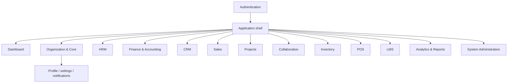

# Navigation & Information Architecture (IA)

| Atribut | Nilai |
|---|---|
| Document Code | DOC-026 |
| Document Version | 0.1 |
| Document Status | DRAFT |
| Created Date | 2026-11-04 |
| Last Updated | 2026-11-04 |
| Document Owner | TBD — Product/UX Owner |
| Related Documents | `../01-requirements/frs.md`, `../02-architecture/module-architecture/module-architecture-specification.md`, `ui-ux-specification.md`, `../../docs/MTS.md` |

## Tujuan dan Prinsip

Menata navigasi web BOS berdasarkan domain dan akses. MTS menetapkan authentication, main application, dashboard, module dan administrative layouts dengan sidebar, top navigation, breadcrumb, page header, search, notification center, user menu, content. Urutan menu, persona, label dan default dashboard TBD dan harus diuji dengan pengguna.

## Sitemap Konseptual

## Navigation Rules

- Main navigation is module/domain oriented; show only modules/routes the user is allowed to discover, but enforce all access server-side.
- Breadcrumb represents location within module; page title and contextual actions remain predictable.
- Global search scope, indexing, authorization and data domains TBD; never reveal unauthorized records.
- POS layout may be task-focused distinct view; offline behavior is TBD.
- System Administration routes require separate permissions and must not expose secrets.
- Responsive behavior, localization, timezone/currency and menu ordering await user research/configuration decisions.

## Open Issues

Persona/role map, module activation/navigation visibility, default landing, global search, deep-link behavior, mobile/tablet support and IA usability test participants TBD.

## References / Change History

MTS §§12.1, 16; DOC-003/010/023/024.

| Versi | Tanggal | Perubahan | Penulis |
|---|---|---|---|
| 0.1 | 2026-11-04 | Sitemap konseptual dan navigation rules | Documentation Agent |
