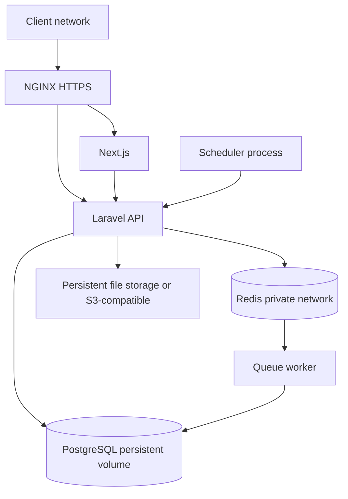

# Infrastructure & Deployment Specification (IDS)

| Atribut | Nilai |
|---|---|
| Document Code | DOC-028 |
| Document Version | 0.1 |
| Document Status | DRAFT |
| Created Date | 2026-11-04 |
| Last Updated | 2026-11-04 |
| Document Owner | TBD — Infrastructure/DevOps Owner |
| Related Documents | `../02-architecture/sas.md`, `../04-backend/backend-technical-specification.md`, `backup-disaster-recovery.md`, `../09-operations/deployment-manual.md`, `../../docs/MTS.md` |

## 1. Tujuan dan Baseline

Self-hosted deployment di Linux; Docker Compose mengelola services; NGINX reverse proxy; Next.js runtime, Laravel/PHP-FPM, PostgreSQL, Redis, worker, scheduler dan persistent file storage. Stack components Laravel/Next/Redis/Compose berstatus Proposed pada MTS decision table sesuai entri; versi final seluruh runtime TBD.

## 2. Logical Deployment

Compose services are conceptual names from MTS. Network topology, ports, subnet, host firewall, replica topology, TLS termination and resource limits are deployment-specific.

## 3. Environment/Configuration

Separate Development, Testing, Staging, Production; config and secret separate from source, environment file not committed. Production must restrict DB/Redis to application network, persist PostgreSQL/files, use HTTPS and least privilege; secrets injected through approved mechanism (manager TBD). Define image provenance, tags/digest, non-root users, health checks, restart, resource limits, logging driver and update policy before deployment.

## 4. Installation and Update

Preflight host/Docker/dependency; provision config, DB, app key/secrets, initial admin/organization, storage/email; migrations; health check; installation lock. Update: validate current version/package, backup, maintenance if needed, migration, deploy, clear cache, restart worker, health check, record. Rollback requires data-aware recovery, not migration down alone.

## 5. Capacity and Availability

MTS performance targets are test baselines only: simple read p95 <500 ms, write <800 ms, dashboard <3 sec in defined environment. Hardware, data, concurrency, workload, sizing, availability, horizontal split of workers, read replica, storage capacity and target uptime TBD. Begin vertical scaling; no initial microservices.

## 6. Open Issues

Linux distro/host size, Docker/Compose versions, image registry/supply chain, TLS/cert renewal, DNS/domain, public ports, backup destination, storage provider, HA/failover, upgrades, secrets, firewall and deployment automation/CI/CD.

## References / Change History

MTS §§1.3, 4, 15–17, 20; DOC-007/008/027/029/032/037/038.

| Versi | Tanggal | Perubahan | Penulis |
|---|---|---|---|
| 0.1 | 2026-11-04 | Logical deployment and operational constraints | Documentation Agent |
